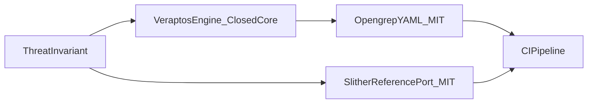

# ⚡ Veraptos Threat Library | Deterministic AppSec Lowering


**Status:** Fixture proof on pinned Damn Vulnerable DeFi + annotated Opengrep tests (**11/11 PASS**, [`test-logs/summary.md`](test-logs/summary.md)). This repo does **not** report precision/recall on production code or on a broad advisory corpus — only the harness below. Advisory metadata for unrelated studies may cite the [GitHub Advisory Database](https://github.com/advisories) (CC-BY 4.0).

**Need custom invariants lowered for an upcoming audit or private codebase?** We deliver custom, high-precision Slither/Opengrep rule packs in **48 hours**.

**Contact:** [Email](mailto:mhiritarek@gmail.com) · [LinkedIn](https://www.linkedin.com/in/tarek-mhiri/)

---

These **10 showcase rules** encode **Veraptos threat invariants** as native Slither detectors and Opengrep YAML, with regression proof on DVD v3.0.0 and annotated fixtures in this repository.

> **Provenance (two parts)**
>
> | Stack | What is in this repo | How it was produced |
> |-------|----------------------|---------------------|
> | **Opengrep (5 packs)** | YAML rules + co-located test files | **Showcase-authored** rules in the engine’s Semgrep/Opengrep YAML format (GraphQL SSRF, DOM XSS, FastAPI, Express, Go JWT). Regression proof is on the fixtures in each pack folder. |
> | **Engine verbatim export** | [`web2-opengrep/_engine-output/`](web2-opengrep/_engine-output/) | **One** checked-in file today: [`veraptos.untrusted-external-interaction.yml`](web2-opengrep/_engine-output/veraptos.untrusted-external-interaction.yml) from `veraptos_static_cli --export-semgrep-python` (see [`PROVENANCE.md`](web2-opengrep/_engine-output/PROVENANCE.md)). **Not** the GraphQL SSRF pack — no TS/GraphQL exporter yet ([`01-graphql-ssrf/`](web2-opengrep/_engine-output/01-graphql-ssrf/)). |
> | **Slither (5 detectors)** | Python plugin modules | **Hand-written reference ports** of the same invariants — there is **no dedicated Slither exporter yet**. We run them on a real **Slither 0.11.6** install (same as CI) against pinned DVD; that validates the invariant on Slither, not that the engine emitted these files. |

> **Architecture boundary**
>
> **Veraptos Engine** (proprietary / closed-core SaaS) **→ emits →** Semgrep/Opengrep-class sink maps and related rule artifacts (**open standard / [MIT](LICENSE)** in this showcase).
>
> **Slither detector modules** in this repo are **reference ports** until a Slither exporter ships. This repository contains **rules, invariants, and tests only** — not CPG lowering source, Z3 implementations, grammar definitions, or private backend ASTs.

Built for bug bounty hunters, boutique audit firms, and enterprise AppSec teams who want **proof**, not slide decks.

## 60-second quickstart

```bash
pip install -e web3-slither-dvd
slither path/to/Contract.sol --detect veraptos-truster-arbitrary-call

opengrep scan --config web2-opengrep/01-graphql-ssrf/graphql-ssrf.yaml path/to/code.ts
```

Full verification (11 harness checks on pinned Damn Vulnerable DeFi v3.0.0):

```bash
# Optional: clone DVD into .targets/damn-vulnerable-defi (gitignored)
python scripts/run_tests.py --only all
```

## Before → After (invariant → native rule)

| Invariant (Before) | Native rule (After) |
|--------------------|------------------------|
| Flash loan must not `functionCall` arbitrary `target` | [`veraptos-truster-arbitrary-call`](web3-slither-dvd/veraptos_dvd/truster/detector.py) |
| ETH balance flash repay + public `deposit()` ledger credit | [`veraptos-side-entrance-state-hijack`](web3-slither-dvd/veraptos_dvd/side_entrance/detector.py) |
| Rewards read snapshot accounting in same tx as deposit | [`veraptos-rewarder-snapshot-manipulation`](web3-slither-dvd/veraptos_dvd/the_rewarder/detector.py) |
| Collateral from DEX spot ratio, not TWAP | [`veraptos-puppet-spot-oracle`](web3-slither-dvd/veraptos_dvd/puppet/detector.py) |
| Public `snapshot()` + governance weight + flash loan | [`veraptos-selfie-governance-snapshot`](web3-slither-dvd/veraptos_dvd/selfie/detector.py) |
| GraphQL args → HTTP client without allowlist | [`graphql-ssrf`](web2-opengrep/01-graphql-ssrf/graphql-ssrf.yaml) |
| `postMessage` → `__html` without origin check | [`dom-xss-postmessage`](web2-opengrep/02-dom-xss-postmessage/dom-xss-postmessage.yaml) |
| Pydantic body → ORM `setattr` without allowlist | [`mass-assignment-fastapi`](web2-opengrep/03-mass-assignment-fastapi/mass-assignment-fastapi.yaml) |
| Express sensitive route without auth middleware | [`express-auth-bypass`](web2-opengrep/04-express-auth-bypass/express-auth-bypass.yaml) |
| JWT parse without strict signing-method binding | [`jwt-none-alg-go`](web2-opengrep/05-jwt-none-alg-go/jwt-none-alg-go.yaml) |

Per-rule **Before / After / Proof** write-ups: [`web3-slither-dvd/veraptos_dvd/*/README.md`](web3-slither-dvd/veraptos_dvd/truster/README.md).

### Worked example (Truster)

**Invariant (3 lines)**

```text
flashLoan MUST NOT call target.functionCall(data)
  UNLESS target == address(token)
```

**Reference Slither detector** (~63 lines, hand-written port): [`truster/detector.py`](web3-slither-dvd/veraptos_dvd/truster/detector.py) — `LibraryCall`/`LowLevelCall` + `is_dependent` on `target`.

**Harness (sanitized)**

```text
expected_dvd_hits>=1 actual_dvd_hits=1
expected_safe_hits=0 actual_safe_hits=0
result=PASS
```



## Contents and test evidence

| Rule | Stack | Fixture | Log |
|------|-------|---------|-----|
| [veraptos-truster-arbitrary-call](web3-slither-dvd/veraptos_dvd/truster/) | Slither | DVD Truster | [log](test-logs/veraptos-truster-arbitrary-call.log) |
| [veraptos-side-entrance-state-hijack](web3-slither-dvd/veraptos_dvd/side_entrance/) | Slither | DVD Side Entrance | [log](test-logs/veraptos-side-entrance-state-hijack.log) |
| [veraptos-rewarder-snapshot-manipulation](web3-slither-dvd/veraptos_dvd/the_rewarder/) | Slither | DVD The Rewarder | [log](test-logs/veraptos-rewarder-snapshot-manipulation.log) |
| [veraptos-puppet-spot-oracle](web3-slither-dvd/veraptos_dvd/puppet/) | Slither | DVD Puppet | [log](test-logs/veraptos-puppet-spot-oracle.log) |
| [veraptos-selfie-governance-snapshot](web3-slither-dvd/veraptos_dvd/selfie/) | Slither | DVD Selfie | [log](test-logs/veraptos-selfie-governance-snapshot.log) |
| [graphql-ssrf](web2-opengrep/01-graphql-ssrf/) | Opengrep | annotated tests | [log](test-logs/graphql-ssrf.log) |
| [dom-xss-postmessage](web2-opengrep/02-dom-xss-postmessage/) | Opengrep | annotated tests | [log](test-logs/dom-xss-postmessage.log) |
| [mass-assignment-fastapi](web2-opengrep/03-mass-assignment-fastapi/) | Opengrep | annotated tests | [log](test-logs/mass-assignment-fastapi.log) |
| [express-auth-bypass](web2-opengrep/04-express-auth-bypass/) | Opengrep | annotated tests | [log](test-logs/express-auth-bypass.log) |
| [jwt-none-alg-go](web2-opengrep/05-jwt-none-alg-go/) | Opengrep | annotated tests | [log](test-logs/jwt-none-alg-go.log) |

**10 public rules · 11/11 harness checks PASS** — [`test-logs/summary.md`](test-logs/summary.md) (DVD `v3.0.0` @ `33120e97…`).

Opengrep locally: download into `.tools/` from [Opengrep releases](https://github.com/opengrep/opengrep/releases) (gitignored).

## Disclaimer: validation scope (TP / TN)

The **11/11 PASS** badge and [`test-logs/`](test-logs/) mean each rule passed **fixed regression fixtures** in [`scripts/run_tests.py`](scripts/run_tests.py). That is **not** a claim of perfect accuracy on arbitrary production code. Below is exactly what was treated as a **true positive (TP)** and **true negative (TN)** in this repository.

### Web3 (Slither) — 5 detectors

| Label | What it means here | Ground truth |
|-------|-------------------|--------------|
| **TP** | Slither reports ≥ 1 finding on the **intended Damn Vulnerable DeFi v3.0.0 contract** for that level (scoped compile under `contracts/<level>/`, pin in [`test-logs/dvd-pin.txt`](test-logs/dvd-pin.txt)) | Public DVD source at tag **v3.0.0** — the known vulnerable challenge implementation |
| **TN** | **Zero** findings from the same detector on the repo’s paired [`safe.sol`](web3-slither-dvd/veraptos_dvd/truster/safe.sol) negative control (minimal patch that encodes the invariant guard) | Our maintained safe fixture — not an independent third-party audit |

**Not measured in this repo:** false positives on unrelated contracts, false negatives on novel exploit variants, or full monorepo Hardhat analysis (Windows full-tree Slither is intentionally avoided; CI uses the same scoped harness on Ubuntu).

### Web2 (Opengrep) — 5 rule packs (6 rule IDs in harness)

| Label | What it means here | Ground truth |
|-------|-------------------|--------------|
| **TP** | Opengrep (`--taint-intrafile`) reports a match on every line marked `ruleid: <id>` in the co-located test file | Annotated **intentionally vulnerable** snippets in [`web2-opengrep/`](web2-opengrep/) |
| **TN** | **No** match on lines marked `ok: <id>` (sanitized / guarded variants in the same file) | Annotated **safe** snippets — not exhaustive secure coding patterns |

**Not measured in this repo:** false positives in your app codebase, false negatives on obfuscated or framework-specific code paths, or coverage outside the small test files shipped here.

Test files and `ruleid` / `ok` markers were **written alongside** the Opengrep rules to pass this harness; they are **not** an independent third-party benchmark.

### Scope and limits (read before CI)

Several rules are **narrow** and tuned to pass TP/TN on the fixtures here:

- **Slither:** Rewarder / Selfie / Puppet logic keys on DVD **contract and function names** (e.g. `TheRewarderPool`, `SimpleGovernance`). Truster targets **`flashLoan` + user-controlled `target`** patterns from the Truster level.
- **Opengrep:** Express rule looks for **`authMiddleware`** on sensitive routes; Go JWT rules include a **literal** `[]byte("secret")` keyfunc pattern; DOM-XSS sink is **`{ __html: ... }`**, not full React data-flow; GraphQL SSRF uses **intrafile taint** on small TypeScript snippets.

A **TN** here means **zero findings on our paired safe fixture**, not proven precision on arbitrary code. Some safe paths pass because names or literals do not match the rule, not because the rule is generally sound.

### What you should do before production CI

Run the rules on **your** trees, triage findings manually, and tune or fork rules for your stack. [`python scripts/run_tests.py --only all`](scripts/run_tests.py) only replays **our** TP/TN contract; it does not score precision/recall on an industry-wide corpus.

## Why teams integrate this

Heuristic linters pattern-match syntax. These rules encode **invariants**—flash-loan semantics, snapshot timing, spot oracles, SSRF taint, auth middleware presence, JWT alg binding—as **reference patterns** you can fork for CI, starting from DVD and annotated proofs in [`test-logs/`](test-logs/).

## Book a 48-hour rule sprint

Custom invariants lowered for your audit scope or private monorepo—Slither + Opengrep packs, CI-ready.

**Contact:** [Email](mailto:mhiritarek@gmail.com) · [LinkedIn](https://www.linkedin.com/in/tarek-mhiri/)

## License

**MIT License** — see [LICENSE](LICENSE). Rules in this repository are unencumbered for commercial integration in CI and audit tooling.

**Evidence pack for reviewers:** [`EVIDENCE.md`](EVIDENCE.md).
